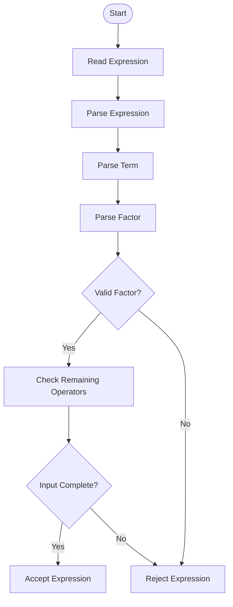
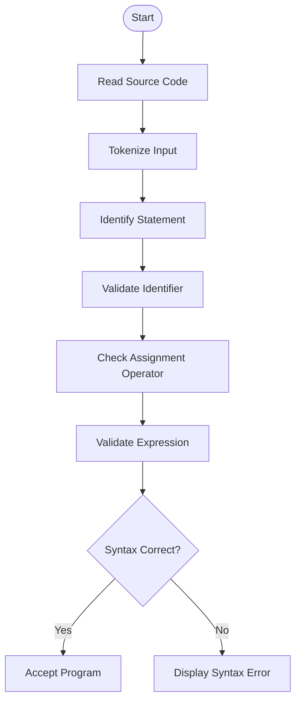
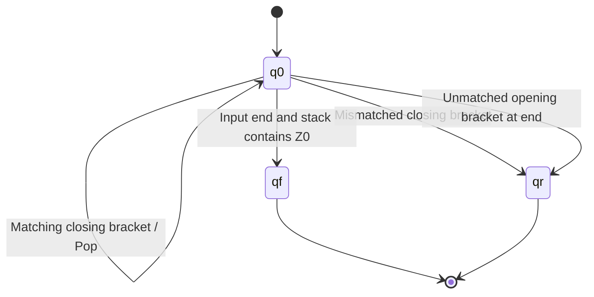
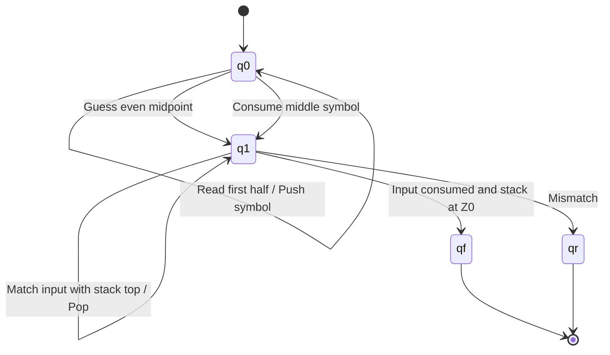
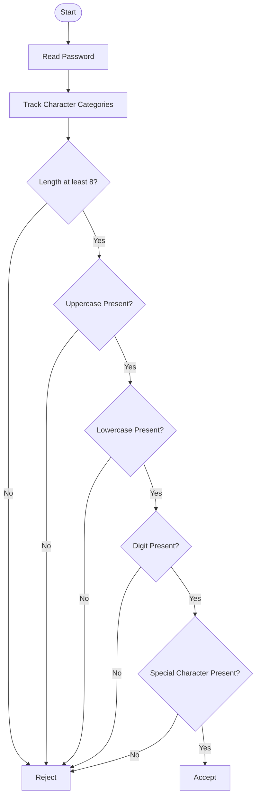

# Case Study-Based Analysis and Design Using PDA and CFG

**Course:** 21CSC301T Formal Language and Automata  
**Assessment:** CLA-2, Assessment Task 3  
**Student:** K Neeraj (RA2411026050023)  
**Programme:** B.Tech AIML 'A', III Year  
**Faculty:** Dr. C. Gunasundari  
**Institution:** SRM IST Tiruchirappalli

---

## 1. Project Overview

This project demonstrates the application of Context-Free Grammars (CFG), Pushdown Automata (PDA), and Finite Automata (FA) through five practical case studies.

The main objective is to understand how formal languages can be used to validate different types of input and how automata process strings using states and stack memory.

### Objectives

- Define the target language before designing the model.
- Construct CFG productions for each case study.
- Design PDA states, stack symbols, and transitions.
- Demonstrate successful and unsuccessful processing.
- Explain ambiguity and determinism.
- Identify situations where finite automata are insufficient.
- Implement and test the validators using Python.

## 2. Case Studies

1. Arithmetic Expression Validation
2. Programming Language Syntax Checker
3. Balanced Parentheses and Brackets
4. Palindrome Checker
5. Password Pattern Validation

---

## 3. Project Structure

```text
PDA-CFG-Case-Studies/
│
├── README.md
├── requirements.txt
├── .gitignore
│
├── pda_cfg/
│   ├── __init__.py
│   ├── grammar.py
│   ├── validators.py
│   ├── cases.py
│   └── cli.py
│
├── tests/
│   └── test_validators.py
│
└── docs/
    └── THEORY.md
```

## 4. Installation and Execution

### Requirements

- Python 3.10 or above
- Pytest for automated testing

### Installation

```bash
git clone YOUR_REPOSITORY_URL
cd PDA-CFG-Case-Studies

pip install -r requirements.txt
```

### Run the Project

```bash
# Run all case studies
python -m pda_cfg.cli all

# Run individual case studies
python -m pda_cfg.cli expr
python -m pda_cfg.cli program
python -m pda_cfg.cli brackets
python -m pda_cfg.cli palindrome
python -m pda_cfg.cli password

# Run automated tests
python -m pytest -q
```

---

# CASE STUDY 1: ARITHMETIC EXPRESSION VALIDATION

## 1.1 Aim

To design a CFG and PDA model that validates arithmetic expressions containing operands, operators, and parentheses.

## 1.2 Target Language

The language accepts arithmetic expressions containing:

- Identifiers such as `a`, `b`, `x`.
- Integer and decimal numbers.
- Addition `+` and subtraction `-`.
- Multiplication `*` and division `/`.
- Parentheses `(` and `)`.

## 1.3 CFG Productions

The grammar is:

```text
E  -> T E'
E' -> + T E' | - T E' | ε

T  -> F T'
T' -> * F T' | / F T' | ε

F  -> ( E ) | id | number
```

Where:

- E = Expression
- T = Term
- F = Factor
- id = Identifier
- ε = Empty string

This grammar follows operator precedence:

1. Parentheses
2. Multiplication and division
3. Addition and subtraction

## 1.4 Expression Parsing Diagram



## 1.5 PDA Model

**States:**

- q0 = Initial state
- q1 = Expression processing
- q2 = Operator processing
- qf = Final accepting state

**Stack Symbols:**

- Z0 = Bottom stack symbol
- E = Expression
- T = Term
- F = Factor
- Operators and parentheses = Grammar terminals

**PDA Processing:**

1. Start with the initial stack symbol.
2. Expand non-terminals using CFG productions.
3. Match terminals with input symbols.
4. Pop matched terminals from the stack.
5. Accept when the input is consumed and the stack is empty except for the bottom marker.

## 1.6 Successful Example

Input:

```text
a + b * (c - 2)
```

The expression is accepted because:

- All operators are correctly placed.
- Parentheses are balanced.
- Multiplication has higher precedence than addition.
- Every operand is valid.

## 1.7 Unsuccessful Examples

| Input | Result | Reason |
|---|---|---|
| a + * b | Rejected | Invalid operator placement |
| (a + b | Rejected | Missing closing bracket |
| a / | Rejected | Missing operand |
| a + b * c | Accepted | Valid expression |

## 1.8 Ambiguity Discussion

A simple grammar:

```text
E -> E + E
   | E * E
   | (E)
   | id
```

is ambiguous because it does not define operator precedence.

For example:

```text
a + b * c
```

can produce different parse trees.

**Revised Grammar:** The E, T, F grammar given in Section 1.3 resolves the ambiguity by separating expressions, terms, and factors.

---

# CASE STUDY 2: PROGRAMMING LANGUAGE SYNTAX CHECKER

## 2.1 Aim

To design a grammar and PDA-based syntax checker for a simplified programming language.

## 2.2 Target Language

The language accepts simple variable declarations and assignments.

Examples:

```text
let x = 10
y = x + 20
let total = a * b
```

Each statement can contain identifiers, numbers, assignment operators, and arithmetic expressions.

## 2.3 CFG Productions

```text
Program -> Statement More

More -> ; Statement More
      | ε

Statement -> let id = Expr
           | id = Expr

Expr -> Term ExprTail

ExprTail -> + Term ExprTail
          | - Term ExprTail
          | ε

Term -> Factor TermTail

TermTail -> * Factor TermTail
          | / Factor TermTail
          | ε

Factor -> ( Expr )
        | id
        | number
```

## 2.4 Syntax Checker Flowchart



## 2.5 PDA Model

**States:**

- q0 = Initial state
- q1 = Declaration processing
- q2 = Assignment processing
- q3 = Expression processing
- qf = Accepting state

**Stack Symbols:**

```text
Z0 = Bottom marker
S  = Statement
E  = Expression
T  = Term
F  = Factor
id = Identifier
```

The PDA uses the stack to manage grammar productions and nested expressions.

## 2.6 Successful Examples

```text
let x = 10
```

```text
x = a + b
```

```text
let total = (a + b) * 5
```

All these inputs follow the grammar.

## 2.7 Unsuccessful Examples

| Input | Result | Reason |
|---|---|---|
| let = 10 | Rejected | Missing identifier |
| x 5 | Rejected | Missing assignment operator |
| a = b + | Rejected | Missing operand |
| let x = 10 | Accepted | Valid declaration |

## 2.8 Ambiguity and Determinism

A programming-language grammar must define operator precedence and statement structure.

The expression grammar separates expressions, terms, and factors, avoiding ambiguity between addition and multiplication.

A predictive parser can process this grammar deterministically with suitable lookahead.

Finite automata alone cannot handle arbitrarily nested parentheses in expressions.

---

# CASE STUDY 3: BALANCED PARENTHESES AND BRACKETS

## 3.1 Aim

To design a PDA that checks whether parentheses, square brackets, and curly brackets are properly balanced.

## 3.2 Target Language

The input alphabet is:

```text
Σ = { (, ), [, ], {, } }
```

A valid string must satisfy:

- Every opening bracket has a matching closing bracket.
- Brackets must close in the correct order.
- No closing bracket can appear without its corresponding opening bracket.

## 3.3 CFG Productions

```text
S -> SS
   | (S)
   | [S]
   | {S}
   | ε
```

Where S is the start symbol.

## 3.4 PDA Model

**States:**

- q0 = Initial and processing state
- qf = Accepting state
- qr = Rejecting state

**Stack Symbols:**

```text
Z0 = Bottom stack marker
A  = Opening parenthesis (
B  = Opening square bracket [
C  = Opening curly bracket {
```

### PDA Operations

| Input | Stack operation |
|---|---|
| ( | Push A |
| [ | Push B |
| { | Push C |
| ) | Pop A only |
| ] | Pop B only |
| } | Pop C only |

If the closing bracket does not match the stack top, the input is rejected.

## 3.5 PDA Diagram



## 3.6 Successful Processing Example

Input:

```text
([])
```

| Input | Stack | Action |
|---|---|---|
| ( | Z0 A | Push A |
| [ | Z0 A B | Push B |
| ] | Z0 A | Pop B |
| ) | Z0 | Pop A |
| End | Z0 | Accept |

The string is accepted because every opening bracket has a matching closing bracket.

## 3.7 Unsuccessful Processing Example

Input:

```text
([)]
```

The processing is:

1. Read `(` and push A.
2. Read `[` and push B.
3. Read `)` while B is on top.
4. The closing parenthesis does not match B.
5. Reject the input.

## 3.8 Why Finite Automata Are Insufficient

A finite automaton cannot remember an unlimited number of opening brackets.

A PDA uses an unbounded stack to store opening brackets and match them with closing brackets.

Therefore, a PDA is suitable for balanced-bracket validation.

---

# CASE STUDY 4: PALINDROME CHECKER

## 4.1 Aim

To design a CFG and PDA model for checking whether a given string is a palindrome.

## 4.2 Target Language

The alphabet is:

```text
Σ = {a, b}
```

A palindrome is a string that reads the same forward and backward.

Examples:

```text
aba
abba
baab
aaa
```

The language contains both even-length and odd-length palindromes, including the empty string.

## 4.3 CFG Productions

```text
S -> aSa
   | bSb
   | a
   | b
   | ε
```

The grammar generates palindromes by adding identical symbols to both ends.

## 4.4 PDA Model

**States:**

- q0 = Initial and push phase
- q1 = Matching phase
- qf = Accepting state
- qr = Rejecting state

**Stack Symbols:**

```text
Z0 = Bottom marker
A  = Symbol a
B  = Symbol b
```

### PDA Working

1. Read the first half of the input.
2. Push each symbol onto the stack.
3. Nondeterministically guess the midpoint.
4. For odd-length strings, consume the middle symbol.
5. Read the remaining half and compare each symbol with the stack top.
6. Pop matching symbols.
7. Accept if the input ends and the stack returns to Z0.

## 4.5 PDA Diagram



## 4.6 Successful Examples

| Input | Reverse | Result |
|---|---|---|
| aba | aba | Accepted |
| abba | abba | Accepted |
| baab | baab | Accepted |
| aaa | aaa | Accepted |

## 4.7 Unsuccessful Examples

| Input | Reverse | Result |
|---|---|---|
| abab | baba | Rejected |
| aab | baa | Rejected |
| abb | bba | Rejected |

## 4.8 Determinism Discussion

The PDA must guess the midpoint because the input does not contain a separator between the two halves.

Therefore, a nondeterministic PDA is suitable for this language.

A finite automaton cannot recognise arbitrary-length palindromes because it cannot remember the complete first half of an input.

---

# CASE STUDY 5: PASSWORD PATTERN VALIDATION

## 5.1 Aim

To validate passwords based on predefined character and length requirements.

## 5.2 Target Language

A valid password must contain:

- At least 8 characters.
- At least one uppercase letter.
- At least one lowercase letter.
- At least one digit.
- At least one permitted special character.

The exact permitted characters are determined by the implementation.

## 5.3 Formal Model

This language is regular because validation requires tracking only a finite set of conditions.

A DFA can track:

- Whether an uppercase letter has appeared.
- Whether a lowercase letter has appeared.
- Whether a digit has appeared.
- Whether a special character has appeared.
- Whether the minimum length has been reached.

No unbounded stack is required.

## 5.4 DFA Flowchart



## 5.5 Successful Examples

```text
Formal@23
Neeraj#123
Hello@2026
```

These examples satisfy the illustrative policy.

## 5.6 Unsuccessful Examples

| Password | Reason |
|---|---|
| formal@23 | No uppercase letter |
| FORMAL@23 | No lowercase letter |
| Formalabcd | No digit or special character |
| Fo@23 | Less than 8 characters |

## 5.7 Why PDA Is Not Required

The password validator checks a finite number of character categories and a minimum length.

A finite automaton can track these conditions using a finite set of states.

Therefore, a DFA is sufficient and a PDA is unnecessary.

This case study demonstrates that not every validation problem requires a context-free grammar.

---

# 6. Comparison of Case Studies

| Case Study | Formal Model | Stack Required? | Reason |
|---|---|---|---|
| Arithmetic Expression | CFG / PDA | Yes, for nesting | Nested parentheses |
| Programming Syntax | CFG / PDA | Yes, for nesting | Recursive syntax |
| Balanced Brackets | CFG / DPDA | Yes | Matching brackets |
| Palindrome | CFG / NPDA | Yes | Comparing both halves |
| Password Validation | Regular Expression / DFA | No | Finite conditions |

---

# 7. Ambiguity Analysis

Ambiguity occurs when a string has more than one valid parse tree or derivation in a grammar.

Consider the grammar:

```text
E -> E + E
   | E * E
   | (E)
   | id
```

The expression:

```text
a + b * c
```

can have multiple parse trees because the grammar does not define operator precedence.

### Revised Unambiguous Grammar

```text
E  -> T E'
E' -> + T E' | - T E' | ε

T  -> F T'
T' -> * F T' | / F T' | ε

F  -> (E) | id | number
```

This grammar gives multiplication and division higher precedence than addition and subtraction.

---

# 8. Importance of PDA and CFG

### Context-Free Grammar

- Describes recursive language structures.
- Defines syntax rules.
- Useful in programming-language design.
- Helps construct parsers.

### Pushdown Automata

- Uses stack memory.
- Recognises context-free languages.
- Handles nested structures.
- Useful for syntax checking and bracket matching.

### Finite Automata

- Uses a finite number of states.
- Recognises regular languages.
- Suitable for password-pattern validation.
- Cannot recognise arbitrary balanced brackets or palindromes.

---

# 9. Conclusion

This project demonstrates the application of Context-Free Grammars and Pushdown Automata in solving practical language-validation problems.

The five case studies explain how CFGs define recursive structures and how PDAs use stack memory to recognise context-free languages.

Arithmetic expressions, programming-language syntax, balanced brackets, and palindromes demonstrate the importance of stack-based processing.

Password validation demonstrates that regular languages can be recognised using finite automata without requiring a stack.

Thus, selecting the correct computational model is essential for designing efficient and accurate language validators.

---

# 10. References

- Course material: 21CSC301T Formal Language and Automata.
- Class notes on Context-Free Grammars and Pushdown Automata.
- Python documentation: https://docs.python.org/3/
- Mermaid documentation: https://mermaid.js.org/

---

**Submitted by:**  
K Neeraj  
RA2411026050023  
B.Tech AIML 'A', III Year  
SRM IST Tiruchirappalli
