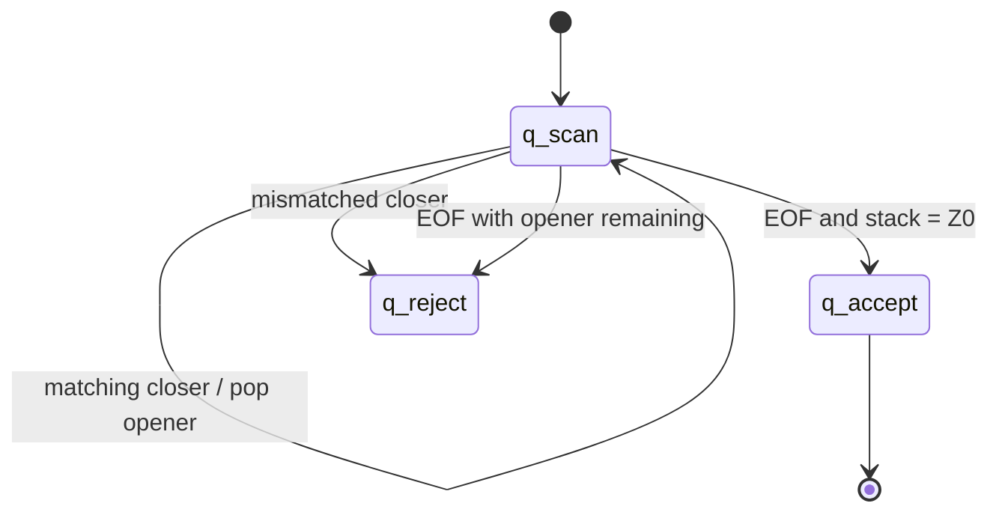
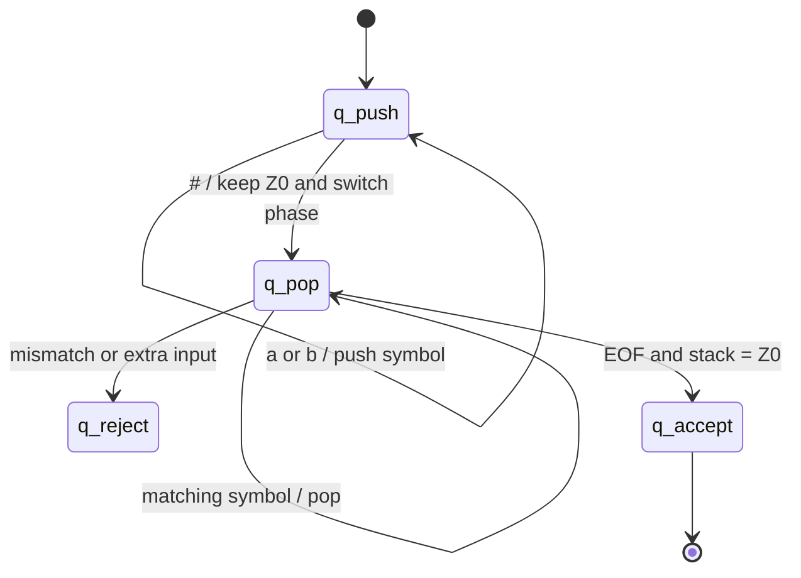
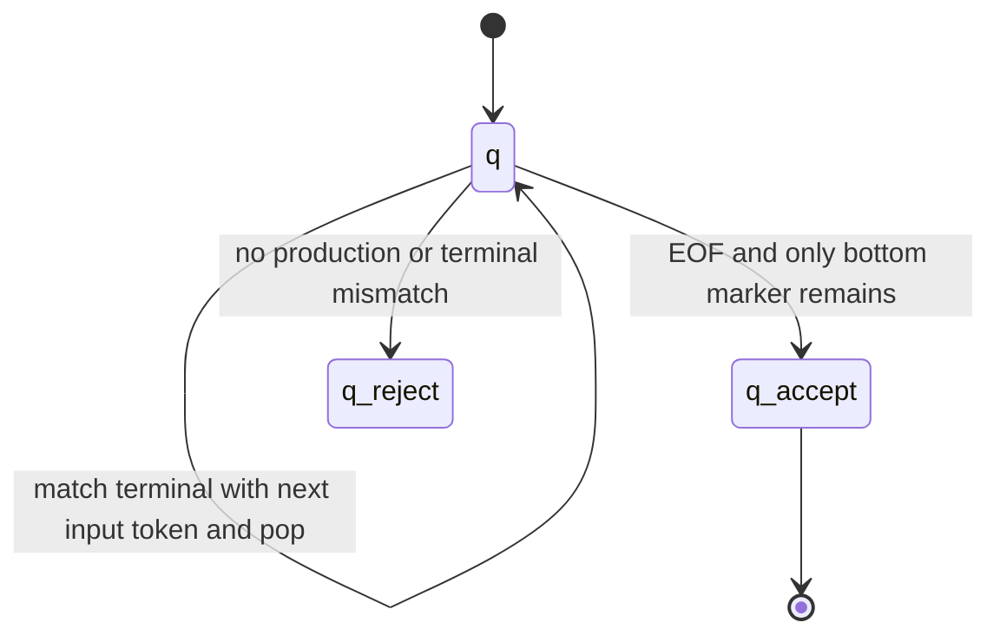

# PDA state diagrams (Mermaid)

These are conceptual state diagrams; stack actions are written on transitions as `input, stack-top → replacement`.

## Balanced brackets DPDA

## Marked palindrome DPDA for `w#w^R`

## CFG-to-PDA construction (arithmetic expressions)

## Password DFA state information

The password DFA can be represented as a finite collection of product states rather than a pushdown automaton. Each state stores `(length_bucket, seen_upper, seen_lower, seen_digit, seen_symbol)`. Whitespace leads to a rejecting sink. The accepting states have `length_bucket=8+` and all four flags set to true.
